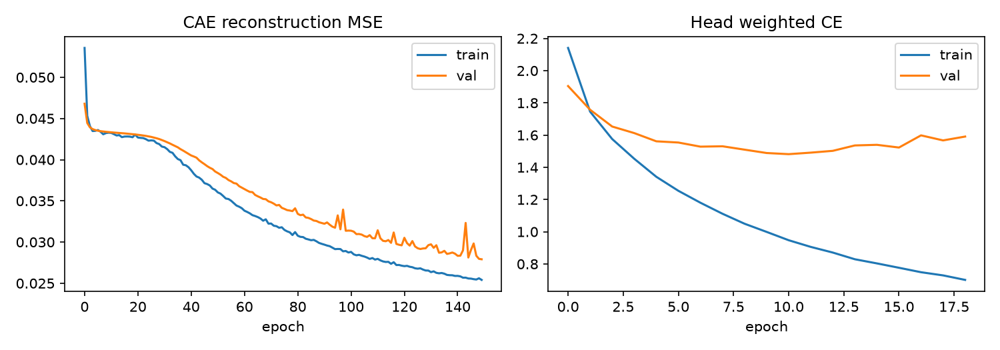
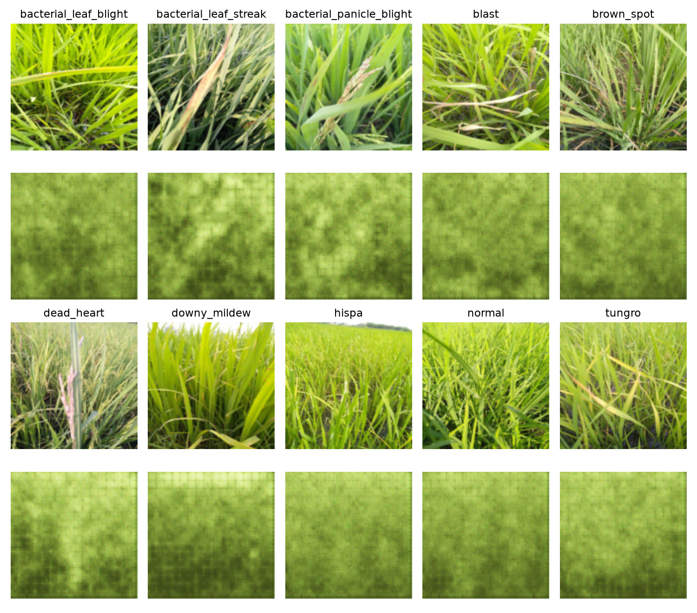
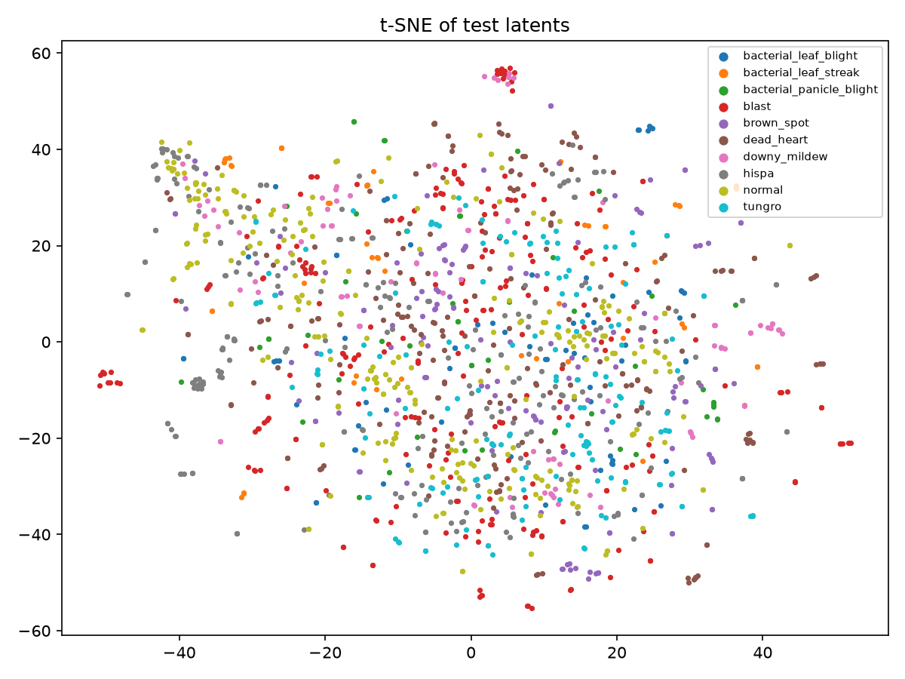
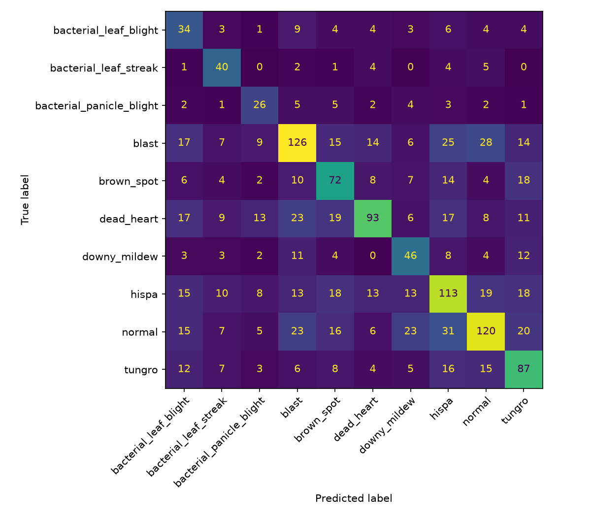

# Paddy Disease Representation using a Convolutional Autoencoder

**Project 29** · T Manoj (2023004133) · Domain: Agriculture · Unit 2 / Unit 3 (CO2, CO3)
Architecture: Convolutional Autoencoder · Training method: Mini-Batch Gradient Descent

## Summary

A convolutional autoencoder (CAE) was trained from scratch, using plain mini-batch gradient descent, to compress 128 × 128 paddy-field photos into a 128-dimensional latent vector. A small dense classifier was then trained on the frozen latents to predict 10 classes (9 diseases + normal).

| Held-out test split (1,564 images) | Macro-F1 | Accuracy |
|---|---|---|
| B1 baseline: PCA-128 on 64 × 64 pixels + logistic regression | 0.370 | 0.389 |
| **E1: CAE latent (128-d), frozen encoder + dense head** | **0.475** | **0.484** |

- **E1 vs B1:** E1 beats the baseline by 0.105 macro-F1, so the learned representation carries more disease signal than an equally sized linear compression of the pixels.
- **0.60 target:** not reached. The PRD treated this number as provisional.
- **Reconstructions:** they do not preserve leaf shape or lesions, which is the main limitation of this result (Section 6).

## 1. Problem and objectives

Diagnosing paddy diseases in the field is slow and depends on experts. This project asks whether an *unsupervised* convolutional representation, learned only by reconstructing images, carries enough disease information to classify leaves from a compact vector.

The project has five objectives:
1. Build a CAE.
2. Train it with mini-batch gradient descent and document convergence.
3. Classify the 10 classes from the frozen latents.
4. Compare against a simple baseline.
5. Report reconstruction loss, a latent-space visualisation and macro-F1.

## 2. Data

**Source:** Kaggle *Paddy Doctor: Paddy Disease Classification*, labelled training set only. The Kaggle test images are unlabelled, so they were not used, and every metric below comes from a held-out part of the labelled set. The `train.csv` metadata (variety, age) was not used as model input.

**Images:** 10,407 RGB photos, all 480 × 640 (landscape or portrait). They are wide field shots of plants rather than close-ups of single leaves.

**Class distribution** ([figure](figs/class_distribution.png)). The largest class (normal) is 5.2 times the smallest (bacterial panicle blight).

| Class | Images | | Class | Images |
|---|---|---|---|---|
| normal | 1,764 | | brown_spot | 965 |
| blast | 1,738 | | downy_mildew | 620 |
| hispa | 1,594 | | bacterial_leaf_blight | 479 |
| dead_heart | 1,442 | | bacterial_leaf_streak | 380 |
| tungro | 1,088 | | bacterial_panicle_blight | 337 |

**Near-duplicate check.**
- **Method:** each image was given a 64-bit difference hash (dHash), and images within a Hamming distance of 2 or less were linked into clusters.
- **Result:** 1,203 images (11.6%) belong to a cluster of two or more images, and 10 of those clusters contain mixed labels.
- **Handling:** instead of deleting duplicates, each cluster was kept entirely inside one split, so no near-copy of a test image is seen in training.

**Split.** The split was stratified and grouped by duplicate cluster (`StratifiedGroupKFold`, 20 folds, seed 42), with 3 folds for test, 3 for validation and 14 for train. The split indices are saved to `artifacts/split.npz` and reused by every experiment.

| Split | Images |
|---|---|
| Train | 7,282 (70.0%) |
| Validation | 1,561 (15.0%) |
| Test | 1,564 (15.0%) |

**Preprocessing and augmentation.**
- **Resizing:** images were resized to 128 × 128, which does not keep the aspect ratio, and pixels were scaled to [0, 1]. No mean/std normalisation was applied.
- **Augmentation (training batches only):** horizontal flip, rotation within ±15° and brightness jitter of ±20%. Validation and test images were never augmented.

## 3. Method

### 3.1 Architecture

| Block | Layers | Output |
|---|---|---|
| Encoder | Conv 3×3, stride 2, 32 → ReLU → Conv 3×3/2, 64 → ReLU → Conv 3×3/2, 128 → ReLU | 16 × 16 × 128 |
| Bottleneck | Flatten → Dense | 128-d latent *z* |
| Decoder | Dense → 16 × 16 × 128 → three ConvTranspose 3×3/2 layers (64, 32, 3) → Sigmoid | 128 × 128 × 3 |
| Classifier head | Dense 128 → 64 → ReLU → Dense 10 (softmax) | 10 classes |

- **Layer details:** all convolutions use "same" padding, and weights use He-normal initialisation.
- **Decoder use:** the decoder is used only in Stage 1. Stage 2 uses the encoder, with its weights frozen.

### 3.2 Training: mini-batch gradient descent

Both stages use plain mini-batch gradient descent (PyTorch `SGD` with momentum 0 for the main model):

θt+1 = θt − η · (1/m) Σi∈Bt ∇θ L(xi; θt)

- **Stage 1 (unsupervised):** MSE reconstruction loss on training images; no labels used.
- **Stage 2 (supervised):** the encoder is frozen and latents are computed once (without augmentation) and standardised with training-set mean/std. The head is trained with class-weighted cross-entropy, using weights inversely proportional to class frequency.
- **Both stages:** each stage uses early stopping on validation loss (patience 8) and restores the best-validation weights.
- **Choosing settings:** every configuration was chosen on the validation split. The test split was used once, for the final B1 and E1 evaluation.
- **Hardware:** NVIDIA RTX 3050 Laptop GPU. One Stage-1 epoch takes about 5.4 s at batch 64 when running alone. Some per-epoch times in the run log are about 2× higher because two runs shared the GPU.

### 3.3 Baseline (B1)

Images were downsampled to 64 × 64 and flattened. A 128-component PCA was then fitted on the training split; it explains 59.8% of the variance. Logistic regression with balanced class weights was trained on the standardised components. B1 has the same latent size as E1, so it isolates whether *learned convolutional* features beat *linear* compression.

## 4. Experiments and tuning

One factor was changed at a time, starting from the PRD's defaults (batch 64, η = 0.01, latent 128, momentum 0).

**Stage 1 sweeps (50 epochs each).** "Head val F1" is a dense head (η = 0.01, batch 64) trained on that run's frozen latents.

| Exp. | Change (others at default) | Best val MSE | Head val macro-F1 | Observation |
|---|---|---|---|---|
| E1-start | η 0.01, batch 64 | 0.0441 | 0.249 | Still decreasing at epoch 50 |
| E3 | **η 0.1** | 0.0428 | 0.233 | Faster; no divergence |
| E3 | η 0.001 | 0.0573 | – | Far too slow |
| E3 | η 0.1, **batch 32** | 0.0386 | 0.306 | Best plain-SGD run at 50 epochs |
| E3 | η 0.1, batch 128 | 0.0433 | – | Fewer updates per epoch, slower |
| E2 | η 0.1, **latent 64** | 0.0421 | 0.207 | |
| E2 | η 0.1, **latent 256** | 0.0431 | 0.299 | Best of the three latent sizes for classification |
| Ablation | η 0.1, momentum 0.9 | 0.0254 | 0.441 | Much faster convergence |
| Ablation | η 0.01, momentum 0.9 | 0.0428 | – | |

**Why each change was made.**
- **Learning rate:** at η = 0.01 the loss was still falling at the epoch cap, so the learning rate was raised to 0.1. That run was stable, so it became the working learning rate.
- **Batch size:** at a fixed learning rate, batch 32 gives twice as many updates per epoch, and it converged faster than batch 64 or 128.
- **Epoch cap:** every plain-SGD run was still improving at 50 epochs, so the chosen configuration was retrained for 150 epochs.

**Long runs (150 epochs).**

| Run | Best val MSE | Head val macro-F1 (head η 0.01) |
|---|---|---|
| **Main: plain SGD, η 0.1, batch 32, latent 128** | **0.0279** | **0.465** |
| Ablation: momentum 0.9, η 0.1, batch 64 | 0.0223 | 0.419 |

**Head learning rate (on the main encoder):** η = 0.001 gave 0.236, η = 0.01 gave 0.465, and **η = 0.1 gave 0.520**. Final E1 uses η = 0.1. Its best validation loss was at epoch 11, and early stopping halted training at epoch 19.

**Not run:** E4 (fine-tuning the encoder) and a 150-epoch run at latent 256.

## 5. Results

### 5.1 Convergence

**Stage 1 (left).**
- **Plateau:** with plain SGD the loss drops quickly to about 0.043 and then stays flat for about 25 epochs. That level matches the network outputting roughly an average green image.
- **Break-out:** after about epoch 25 the loss starts falling steadily again. This plateau explains why every 50-epoch plain-SGD run looked similar, and why longer training mattered more than any single hyperparameter.
- **Generalisation:** final MSE is 0.0254 on train, 0.0279 on validation and **0.0278 on test**. Validation tracks training closely.
- **Instability:** small validation spikes after about epoch 90 suggest η = 0.1 is close to the stable limit.

**Stage 2 (right).** Training loss keeps falling, but validation loss bottoms out around epoch 10 and then rises. The head overfits quickly, and early stopping handles it.

### 5.2 Reconstructions

*One test image per class (rows 1 and 3) and its CAE reconstruction directly below (rows 2 and 4).*

The reconstructions keep only the overall colour and the coarse light/dark layout. Individual leaves, leaf edges and lesions are **not** preserved, and a regular grid artifact is visible. The grid likely comes from the dense layer that expands *z* back to a 16 × 16 map, followed by stride-2 transposed convolutions. **The PRD acceptance criterion, "leaf shape and lesion regions visibly preserved", is not met.**

### 5.3 Latent space

The t-SNE of the test latents is mostly one mixed cloud, so the classes are not cleanly separated. There are some weak trends:
- normal, hispa and bacterial_leaf_streak points gather toward the upper left
- tungro and brown_spot gather toward the lower centre-right

There are a few small tight clusters, mainly of blast and hispa. They are probably photos from the same plot or session that look nearly identical without passing the duplicate threshold. These clusters may make some classes look easier than they really are.

### 5.4 Classification (test split)

| Class | Precision | Recall | F1 | Support |
|---|---|---|---|---|
| bacterial_leaf_blight | 0.279 | 0.472 | **0.351** | 72 |
| bacterial_leaf_streak | 0.440 | 0.702 | 0.541 | 57 |
| bacterial_panicle_blight | 0.377 | 0.510 | 0.433 | 51 |
| blast | 0.553 | 0.483 | 0.515 | 261 |
| brown_spot | 0.444 | 0.497 | 0.469 | 145 |
| dead_heart | 0.628 | 0.431 | 0.511 | 216 |
| downy_mildew | 0.407 | 0.495 | 0.447 | 93 |
| hispa | 0.477 | 0.471 | 0.474 | 240 |
| normal | 0.574 | 0.451 | 0.505 | 266 |
| tungro | 0.470 | 0.534 | 0.500 | 163 |
| **Macro average** | 0.465 | 0.504 | **0.475** | 1,564 |
| Accuracy | | | 0.484 | |

**Weakest classes and likely causes.**
- **bacterial_leaf_blight (F1 0.35):** recall is acceptable (0.47), but precision is 0.28. Many blast, dead_heart, hispa and normal images are predicted as BLB. The class weights push predictions toward small classes, and BLB's yellowing leaf tips look like other yellow-tinted images at this resolution.
- **bacterial_panicle_blight (F1 0.43):** the smallest class (337 images). The disease appears on the panicle, a small region that 128 × 128 resizing and a blurry latent cannot resolve.
- **normal, hispa and blast** are the largest classes and are frequently confused with each other. For example, 31 normal images were predicted as hispa, and 28 blast images were predicted as normal. Their visual differences are small lesions or scrape marks, which is exactly what the reconstructions lose.

Small classes get higher recall than precision, which is the expected effect of class-weighted loss: it trades precision on small classes for recall.

## 6. Discussion

**Does the learned representation help?** Yes, but modestly. E1 beats B1 by 0.105 macro-F1 on test, at the same 128-d size. The reconstructions show that the latent mostly encodes colour, brightness and coarse texture rather than lesion shapes. That is the "latent captures colour/background, not lesions" risk listed in the PRD, and it happened. Those global statistics are still more discriminative than linear PCA components, which is where the gain comes from.

**Mini-batch gradient descent behaviour.**
- **Learning rate** was the most important setting: η = 0.001 barely moved in 50 epochs, and η = 0.1 was fastest while staying stable.
- **Smaller batches** helped at a fixed learning rate, because there are more updates per epoch.
- **The plateau:** plain SGD sits on a plateau near the "average image" solution for about 25 epochs, so it needs a long run.
- **Momentum:** momentum 0.9 escaped that plateau much faster and reached lower reconstruction loss. Its latents classified slightly *worse* after 150 epochs (0.419 vs 0.465), so lower reconstruction error did not mean better disease features. Momentum is reported only as an ablation; the main model uses plain SGD as assigned.

**Validation vs test.** E1 scored 0.520 on validation and 0.475 on test. Many configurations were compared on the same validation split, so the validation number is optimistic. The test number, evaluated once, is the one to quote.

## 7. Limitations

- **Reconstruction quality fails its acceptance criterion.** Detail is lost because the bottleneck squeezes a 32,768-value feature map into 128 numbers through one dense layer, with only three convolution layers. MSE also favours blurry average outputs.
- **Input resolution.** 480 × 640 field photos were reduced to 128 × 128 without keeping the aspect ratio. Lesions that are a few pixels wide in the original are mostly lost before the model sees them.
- **Frozen encoder trained without labels.** Nothing in Stage 1 tells the encoder which details are diagnostic.
- **Duplicate detection** used dHash with a strict threshold. The tight t-SNE clusters suggest some near-identical photos from the same session remain, possibly split across train and test.
- **Single seed.** All results use seed 42 with no repeats, so differences of a few F1 points between configurations may be noise.
- **Not run:** E4 (fine-tuning) and a long latent-256 run.

## 8. Future work

1. Train a 150-epoch latent-256 model. It was the best latent size for classification at 50 epochs.
2. Run E4 (unfreeze the encoder with a low learning rate) to get the upper bound for this architecture.
3. Add a fourth convolution layer or use a convolutional bottleneck, so less spatial detail is discarded.
4. Use larger inputs (e.g. 224 × 224), or crop patches around the leaves.
5. Repeat the key runs over three seeds and report the mean ± standard deviation.

## Appendix: reproducibility

- **Code:** `src/01_eda_split.py` → `02_baseline.py` → `03_train_ae.py` → `04_train_head.py` → `05_final_report.py`. The exact commands are in `README.md`.
- **Fixed seed:** 42. Split indices are in `artifacts/split.npz`, and EDA statistics are in `artifacts/eda.json`.
- **Experiment log:** `runs/experiment_log.csv`, one row per run.
- **Final models:** encoder `runs/cae_z128_b32_lr0.1_m0.0.pt`; head run `cae_z128_b32_lr0.1_m0.0__head_b64_lr0.1`.
- **Run-name overwrite:** the 150-epoch main run reused the name of the earlier 50-epoch batch-32 run, so the saved weights are from the 150-epoch run. Both runs have rows in the experiment log.
